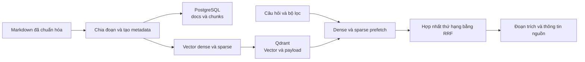

# Chatbot Data Science Advisor

Hệ thống lập chỉ mục và truy xuất tài liệu tiếng Việt phục vụ tư vấn ngành Khoa học dữ liệu và tra cứu thông tin học vụ tại Trường Đại học Công nghiệp TP. Hồ Chí Minh (IUH). Kho dữ liệu bao gồm tuyển sinh, chương trình đào tạo, nghề nghiệp, xu hướng thị trường, quy chế, học bổng, học phí và hỗ trợ sinh viên.

Bản hiện tại có API FastAPI và giao diện chat web. API truy xuất tài liệu từ Qdrant, gửi các đoạn liên quan cho Ollama và trả dần câu trả lời kèm nguồn. SQLite lưu tài khoản và lịch sử hội thoại khi người dùng đăng nhập.

## Kiến trúc



- **PostgreSQL** lưu tài liệu và đoạn văn bản trong hai bảng `docs` và `chunks`. Alembic quản lý schema.
- **Qdrant** lưu một point cho mỗi đoạn, cùng hai named vector `dense` và `sparse`. Payload liên kết với PostgreSQL qua `doc_id` và `chunk_id`, đồng thời chứa tiêu đề, nội dung, mục và URL nguồn.
- **Dense retrieval** dùng `qwen3-embedding:4b` qua Ollama để tìm theo ngữ nghĩa. **Sparse retrieval** dùng trọng số từ khóa tính trong pipeline kết hợp với IDF của Qdrant. Hybrid search hợp nhất hai danh sách theo thứ hạng bằng Reciprocal Rank Fusion (RRF).
- **Filtering** áp dụng điều kiện bắt buộc cho cả hai nhánh trước khi hợp nhất. Bộ lọc riêng của mỗi nhánh được kết hợp với bộ lọc chung bằng phép AND. Payload hỗ trợ các trường như `doc_id`, `category` và `published_date`.

## Yêu cầu môi trường

- Python theo [.python-version](.python-version), hiện là 3.13, và `uv` để đồng bộ phụ thuộc.
- Docker và Docker Compose để chạy PostgreSQL 17. Các lệnh dưới đây cũng dùng Docker cho Qdrant và Ollama.
- Cấu hình phụ thuộc hiện tại lấy PyTorch và TorchVision từ kho wheel CUDA khai báo trong [pyproject.toml](pyproject.toml). Máy không có wheel tương thích với cấu hình này cần điều chỉnh cấu hình phụ thuộc theo môi trường.

## Chạy cục bộ trên Windows

Hướng dẫn này dùng PowerShell tại thư mục gốc của repo và collection `QQ` đã được lập chỉ mục. Mở Docker Desktop và đợi Docker Engine sẵn sàng trước khi chạy lệnh.

### 1. Đồng bộ thư viện và khởi động dịch vụ

```powershell
uv sync --locked
docker compose up -d --wait
docker start ds-advisor-qdrant ds-advisor-ollama
```

Docker Compose khởi động PostgreSQL. API hỏi đáp đọc dữ liệu đã lập chỉ mục từ Qdrant. PostgreSQL phục vụ bước nạp dữ liệu và có thể bỏ qua khi chỉ chạy chat với collection có sẵn.

Nếu Docker báo thiếu container Qdrant hoặc Ollama, chạy lệnh tạo tương ứng. Nếu volume cũ vẫn còn, các lệnh dùng lại dữ liệu trong volume đó.

```powershell
docker run -d --name ds-advisor-qdrant -p 127.0.0.1:6333:6333 -v ds-advisor-qdrant:/qdrant/storage qdrant/qdrant:latest
docker run -d --name ds-advisor-ollama -p 127.0.0.1:11434:11434 -v ds-advisor-ollama:/root/.ollama ollama/ollama
```

Kiểm tra mô hình bằng `docker exec ds-advisor-ollama ollama list`. Chạy lệnh tương ứng nếu thiếu mô hình.

```powershell
docker exec ds-advisor-ollama ollama pull qwen3-embedding:4b
docker exec ds-advisor-ollama ollama pull qwen3.5:4b
```

### 2. Kiểm tra dữ liệu trong Qdrant

```powershell
(Invoke-RestMethod -Method Post `
    -Uri 'http://127.0.0.1:6333/collections/QQ/points/count' `
    -ContentType 'application/json' `
    -Body '{"exact":true}').result.count
```

Collection đã kiểm chứng trước đây có **740 điểm**. Nếu đang dùng collection đó và lệnh trả về `740`, tiếp tục bước 3. Khi dùng một bộ dữ liệu khác, đối chiếu số điểm với lần lập chỉ mục tương ứng.

Nếu lệnh báo `404` hoặc trả về `0`, cần khôi phục collection `QQ` từ volume hoặc bản sao dữ liệu có sẵn. Trên bản `main` hiện tại, [`pipline.py`](pipline.py) gọi `splitter` trước khi khởi tạo và các bước ghi PostgreSQL, tạo vector tài liệu và upsert Qdrant đang bị comment. Với môi trường cài mới chưa có dữ liệu, cần sửa pipeline trước khi dùng nó để tạo `QQ`.

### 3. Chạy FastAPI và mở giao diện

```powershell
$env:RETRIEVER = 'qdrant'
$env:LLM = 'ollama'
$env:HOST = 'http://127.0.0.1:6333'
$env:OLLAMA_HOST = 'http://127.0.0.1:11434'
$env:AUTH_REQUIRED = '0'
$env:RERANK = '0'

uv run --locked uvicorn api.main:app --host 127.0.0.1 --port 8000
```

Khi Uvicorn báo đã chạy, giữ terminal mở và truy cập [giao diện chat](http://127.0.0.1:8000). Dùng [`/health`](http://127.0.0.1:8000/health) để xác nhận API đã bật `retriever=qdrant` và `llm=ollama`.

Câu hỏi thử:

> Theo quy chế đào tạo tín chỉ ban hành năm 2025, sinh viên bị buộc thôi học trong những trường hợp nào?

`AUTH_REQUIRED=0` cho phép chat khi chưa đăng nhập. Đặt `AUTH_REQUIRED=1` trước khi khởi động API nếu muốn yêu cầu đăng nhập và lưu lịch sử theo tài khoản. Sau khi khởi động lại máy, mở Docker Desktop, khởi động các container rồi chạy lại bước 3. Chạy lại `uv sync --locked` khi pull về thay đổi phụ thuộc.

Xem thêm biến môi trường và cách chạy đánh giá trong [tài liệu API](api/README.md).

## Ví dụ truy xuất có bộ lọc

Lưu ví dụ vào một tệp Python ở thư mục gốc và chạy bằng `uv run --locked python <tên-tệp>.py`. Ví dụ lọc nhóm `regulation` và in tiêu đề, mục cùng URL của các đoạn được tìm thấy.

```python
import asyncio

from qdrant_client import models

from config import EmbeddingsConfig, QdrantConfig
from db import create_qdrant_client
from rag.embeddings import ModelEmbeddings, SparseEmbedding
from rag.retrieval import QdrantSearch


async def main():
    question = "Quy định về buộc thôi học"
    client = create_qdrant_client(QdrantConfig())
    try:
        searcher = QdrantSearch(collection_name="QQ", client=client)
        embedder = ModelEmbeddings(config=EmbeddingsConfig())
        doc_filter = models.Filter(
            must=[
                models.FieldCondition(
                    key="category",
                    match=models.MatchValue(value="regulation"),
                )
            ]
        )

        results = await searcher.hybrid_search(
            query_vector=await embedder.aembedding_query(question),
            sparse_vector=SparseEmbedding.sparse_query(question),
            filter=doc_filter,
            limit=5,
            format=True,
        )
        for point in results:
            print(point.title, " / ".join(point.section_path), point.url)
    finally:
        await client.close()


if __name__ == "__main__":
    asyncio.run(main())
```

Để giới hạn truy vấn vào một tài liệu cụ thể, dùng `FieldCondition` với `key="doc_id"` và giá trị lấy từ bảng `docs` hoặc payload. Cả `search()` và `hybrid_search()` mặc định trả response Qdrant. Với `format=True`, chúng trả `list[QueryPoint]`. Khi truy vấn thành công nhưng bộ lọc không khớp, danh sách điểm rỗng. Lỗi truy vấn được truyền về bên gọi.

## Kiểm chứng và đánh giá

Kiểm thử tích hợp trên collection `QQ` đã chạy truy vấn dense-only, sparse-only và hybrid. Với câu “Quy định về buộc thôi học”, bộ lọc theo `doc_id` của Quy chế đào tạo tín chỉ ban hành năm 2025 trả về 5 đoạn, tất cả thuộc đúng tài liệu. Các ca lọc xung đột, bộ lọc không khớp, thiếu vector và lỗi Qdrant `404` cũng đã được kiểm tra.

Để đánh giá chất lượng truy xuất, dùng cùng một tập câu hỏi có nhãn nguồn hoặc đoạn đúng cho cả ba chế độ. Báo cáo **Hit@5** cho tỷ lệ câu có ít nhất một kết quả đúng trong top 5, **MRR@5** cho thứ hạng của kết quả đúng đầu tiên và **p50/p95** cho độ trễ. Khi đánh giá bộ lọc, kiểm tra riêng tỷ lệ kết quả thỏa tất cả điều kiện bắt buộc. Repo chưa công bố kết quả benchmark trên tập câu hỏi có nhãn.

## Cấu trúc mã nguồn

| Đường dẫn | Vai trò |
| --- | --- |
| [`pipline.py`](pipline.py) | Điểm chạy pipeline lập chỉ mục |
| [`data/`](data/) | Nguồn thô và tài liệu Markdown đã chuẩn hóa |
| [`rag/ingestion/`](rag/ingestion/) | Đọc, chia đoạn và lập chỉ mục |
| [`rag/embeddings/`](rag/embeddings/) | Tạo vector dense và sparse |
| [`rag/retrieval/`](rag/retrieval/) | Truy xuất Qdrant, hợp nhất và lọc kết quả |
| [`rag/rerank/`](rag/rerank/) | Mô-đun cross-encoder |
| [`db/`](db/) và [`alembic/`](alembic/) | Kết nối, mô hình lưu trữ, payload index và migration |
| [`agent/`](agent/) và [`config/`](config/) | Cấu hình, trình nạp mô hình và prompt |

## Giấy phép

Mã nguồn được phân phối theo [Apache License 2.0](LICENSE). Thông tin nguồn và giấy phép của từng tài liệu được lưu trong metadata của dữ liệu.
